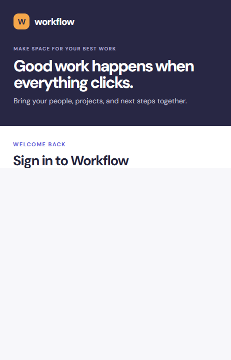

# WorkFlow Frontend

WorkFlow is a team collaboration app for organizing projects, tasks, and conversations. This repository contains its React single-page frontend, built with Vite. The backend API, database, and deployment configuration are documented in the [Workflow API repository](https://github.com/ifraheemfarooqui/Workflow_api).

## Screenshots

The sign-in view below is captured from the local application with no account information entered.



## Project overview

WorkFlow brings teams, projects, tasks, comments, and conversations into one workspace. Users can navigate to workspace areas through URL-addressable pages, collaborate in real time, and manage their account settings.

## Features

- Register, sign in, and sign out.
- Navigate the workspace using URL-addressable dashboard, team, project, task, team-chat, direct-chat, and profile pages.
- View workspace team/project/task summaries on the dashboard; view projects on each team's page.
- Create teams and projects, invite teammates by email, accept pending invitations from the Messages sidebar, add managed teams to projects, join discoverable teams, and collapse/expand the sidebar's team list.
- Search teammates by name or email. Search requires at least two characters and results are limited by the API to contacts sharing a team with the signed-in user.
- Use team chat and one-to-one direct messages with shared-team contacts. The chat view loads the latest message batch, applies live WebSocket updates with reconnect attempts, supports message editing/deletion, and provides emoji insertion. The API supports older-message pagination; the current interface does not expose a load-older control.
- View a project's tasks grouped by status, create tasks with priority and optional team and individual assignees, update task status, and delete tasks.
- Read and add task comments.
- View unread notifications for team, project, task, and comment activity; task-change notifications include updated project completion counts.
- Open a notification to navigate to its related team, project, or task; notification activity refreshes automatically while the workspace is open.
- Update profile name/email, change a password, request password recovery, and request/confirm account deletion with a code sent to the account email.
- Display API errors and provide a workspace reload action after a load failure.

## Routes

| URL | Page |
| --- | --- |
| `/login` | Sign in and account registration |
| `/` | Workspace dashboard |
| `/teams/:teamId` | Team overview and project cards |
| `/teams/:teamId/projects/:projectId` | Project task board |
| `/teams/:teamId/projects/:projectId/tasks/:taskId` | Task details and comments, shown as a dialog over the project |
| `/messages/teams/:teamId` | Team chat |
| `/messages/direct/:userId` | One-to-one chat |
| `/profile` | Profile, password, and deletion settings |
| `/forgot-password` | Request password recovery |
| `/reset-password?token=...` | Set a new password using the emailed token |

The route parser and URL builders are in `src/routing/routes.js`. Workspace routes require a signed-in session; invalid or inaccessible team/project/task routes return to the workspace.

## Layout and source structure

```text
workflow_frontend/
├── App.jsx                 # Workspace data, route guards, page composition
├── main.jsx                # React entry point
├── styles.css              # Application and responsive layout styles
└── src/
    ├── api/client.js        # HTTP and WebSocket client
    ├── routing/routes.js    # URL parsing and navigation
    ├── hooks/               # Shared UI hooks
    └── components/          # Sidebar, boards, dialogs, chat, and account pages
```

The layout has responsive CSS rules for narrow and wide viewports. No formal minimum or maximum supported viewport width is declared by the application.

## Configuration

Set `VITE_API_URL` to the base URL of the running API before starting or building the frontend. If unset, the client uses `http://localhost:8000`. The WebSocket URL is derived from this value (`http` becomes `ws`, and `https` becomes `wss`).

The browser stores the bearer token in local storage. API requests include it in the `Authorization` header. A 401 response clears the stored token and signals the app to return to sign-in.

## Development and production build

Requirements: Node.js 18 or later and npm. From the frontend repository root, install the exact dependencies recorded in `package-lock.json`:

```powershell
npm ci
```

Point the frontend at a running Workflow API (the API must allow the frontend's origin in its CORS configuration):

```powershell
$env:VITE_API_URL = "http://localhost:8000"
```

Start the Vite development server:

```powershell
npm run dev
```

Create a production build:

```powershell
npm run build
```

Preview the production build:

```powershell
npm run preview
```

## Automated frontend tests

The frontend uses Vitest, jsdom, and Testing Library for component and route interaction tests:

```powershell
npm test
```

Tests cover route-to-URL state, sign-in/registration interactions, team list collapse, project creation input handling, task status changes/opening, WebSocket chat send/acknowledgement, and the profile deletion-code UI flow. These component tests mock external services; they do not replace a live browser/API end-to-end test.

## Verification scope

`npm run build` verifies that Vite can compile and bundle the frontend. `npm test` exercises local component interactions and routes. Neither check alone verifies complete browser/backend integration; perform manual browser checks for live API, WebSocket, and email delivery. Backend behavior and its test command are documented in the [Workflow API repository README](https://github.com/ifraheemfarooqui/Workflow_api).
